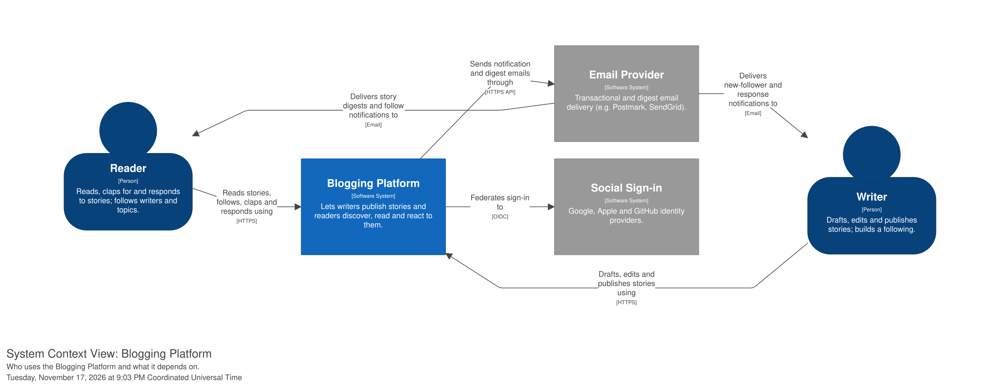
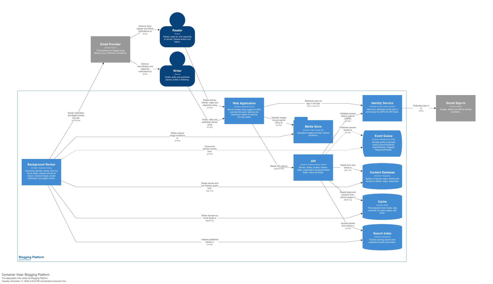
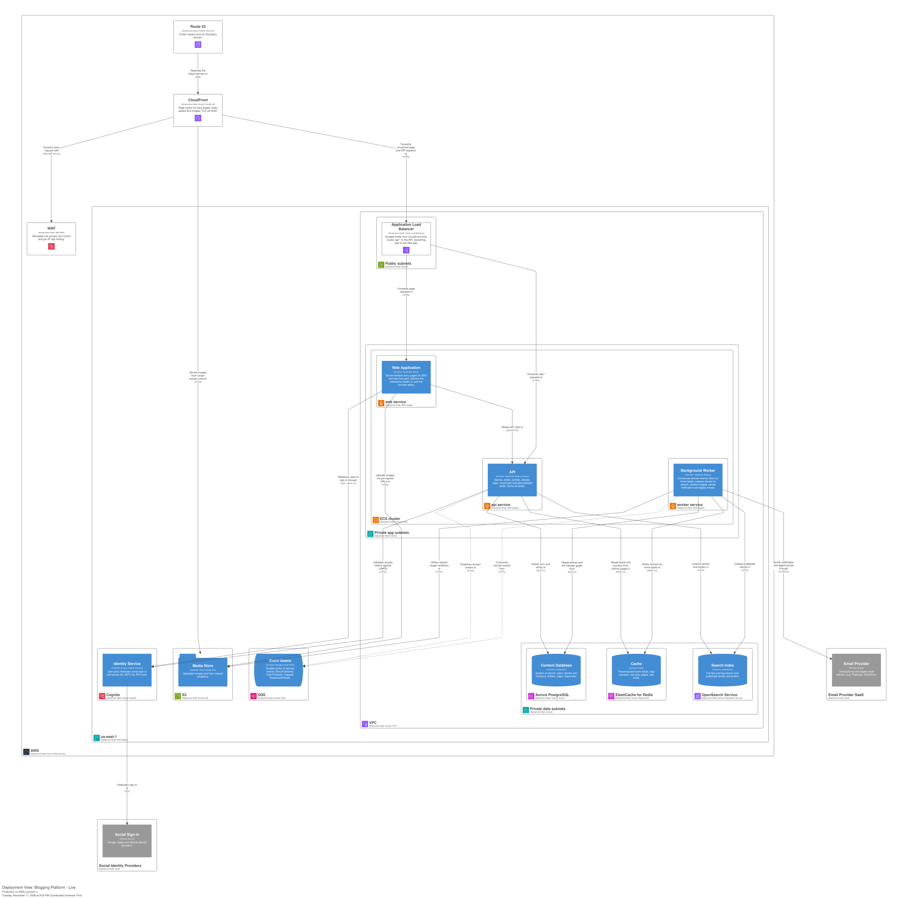

# Sample: blogging platform on AWS (scope given up front, deployment view with icons)

What the skill does when the scope is already in the prompt: no questions, straight to System Context, Container, and a Live deployment view on AWS with the bundled AWS icon theme. It also wrote a system-design note and three proposed ADRs, because the prompt asked for "a system design".

Generated 2026-11-17 by running the real skill headless, unedited: `claude -p` with the `allensanborn-skills` plugin loaded from commit `1c96516` (`--plugin-dir`), model `claude-opus-5-5`, Tier 1 (Docker, headless Structurizr `2026.10.26-playwright`, no MCP), user settings excluded (`--setting-sources project,local`) so no personal instructions leaked in. The skill's replies below are verbatim; only the headings between turns are added. Cost: $1.00, 31 agent turns, one user turn. This is eval case 13's prompt.

## Output

| File | What it is |
| --- | --- |
| [workspace.dsl](./workspace.dsl) | The one model all three views come from |
| [SystemContext.svg](./SystemContext.svg) | System Context view |
| [Containers.svg](./Containers.svg) | Container view |
| [LiveDeployment.svg](./LiveDeployment.svg) | Live deployment on AWS, with icons (large: open it and zoom) |
| [docs/01-system-design.md](./docs/01-system-design.md) | Sizing, read and write paths, reliability notes |
| [adrs/](./adrs/) | Three proposed decision records |

## Transcript

<!-- Verbatim chat output: chat-style lists and bold leads are kept as written. -->
<!-- markdownlint-disable MD032 MD034 MD036 -->

### Turn 1

**User:**

> Design a Medium-style blogging app and a system design for running it on AWS. Show me the different levels of C4 diagrams, including a deployment diagram with AWS icons.
>
> Scope answers up front, so you don't need to ask: the audience is our engineers plus an AWS design review; the system is the blogging platform, one system in one workspace; the actors are readers and writers; the external systems are an email provider and social sign-in; draw System Context, Container, and a Live deployment view on AWS.

**Skill:**

I've designed the platform and drawn three C4 views from one Structurizr model: System Context, Container, and Live deployment on AWS with AWS icons. All three views pass validation and the model lint with no findings, and I looked at every rendered image before exporting.

**Where things are** (all in `docs/architecture/`)
- `workspace.dsl` holds the model and the three views; the diagrams are generated from it.
- `docs/01-system-design.md` has the sizing assumptions, the read and write paths, the data model, and the reliability, security and delivery notes.
- `adrs/`: three decision records, all marked Proposed: ECS on Fargate for compute, hybrid feed fan-out, and a single region spread across two Availability Zones.
- `exports/` has a PNG and SVG of each view plus its legend: `SystemContext`, `Containers`, `LiveDeployment`.

**The design**
- **System Context:** readers and writers use the Blogging Platform. It sends email through an external email provider and federates social sign-in to Google, Apple and GitHub.
- **Containers:**
  - **Web Application** (Next.js): renders story pages on the server for search engines and fast loading, and provides the reader UI and the editor.
  - **API** (Node.js): owns all writes.
  - **Background Worker:** builds home feeds, indexes stories for search, resizes images and sends email.
  - **Identity Service** (Cognito).
  - **Event Queue.**
  - **Data stores:** PostgreSQL (the system of record), Redis, OpenSearch, and S3 for images.

  Event traffic through the queue is drawn as dashed lines.
- **Live deployment (us-east-1):**
  - Route 53 → CloudFront with WAF → ALB in the public subnets.
  - Three ECS services on Fargate (web, api, worker) in private app subnets.
  - Aurora PostgreSQL, ElastiCache and OpenSearch in private data subnets with no internet route.
  - Cognito, S3 and SQS as regional managed services.

  The AWS icons appear only on the deployment view; the context and container diagrams stay technology-neutral.

The design follows from an assumed read-to-write ratio of about 100:1. Most reads are served from the CloudFront cache, writes go to Aurora, and anything slow goes onto the queue. Images upload straight from the browser to S3 using pre-signed URLs, so they never pass through the API.

**Layout fix:** the first left-to-right render of the deployment view had two problems: the Cognito, S3 and SQS boxes overlapped, and the edges from the API and worker were a tangle. Switching that view to a top-to-bottom layout with wider spacing fixed both. The container and context views were clean as first rendered.

**Things I assumed that the AWS review will probably challenge:**
1. **Is Cognito part of our system or an external one?** I drew it as a container inside our system because we configure and run the user pool, and the external "Social Sign-in" sits behind it. If your reviewers treat Cognito as external, the context diagram gains a third external system.
2. **How does the API publish events?** The design doc says the API writes events to an outbox table and relays them to SQS, so no event is lost if SQS is briefly down. The diagram only shows "API publishes to queue". Do you want the outbox step drawn, or is it a detail for the code?
3. **Which email provider?** You said "an email provider", so I used an external SaaS (Postmark or SendGrid) and gave the worker internet access through NAT gateways. If it's actually Amazon SES, it moves inside AWS and the NAT dependency for email goes away.
4. **Are the sizing numbers right?** 5M monthly readers and about 3,000 page views per second at peak are my placeholders. The task counts and the 10k-follower cutoff for feed fan-out both depend on them, so please confirm or correct them before the review.
5. **No browser in the deployment view.** I left out a browser box because the web app renders on the server. If someone asks where the editor's client code runs, the answer is the browser, loaded through CloudFront.

To adjust the layout by hand, run `structurizr/structurizr local` against this folder and open it at http://localhost:8080.
