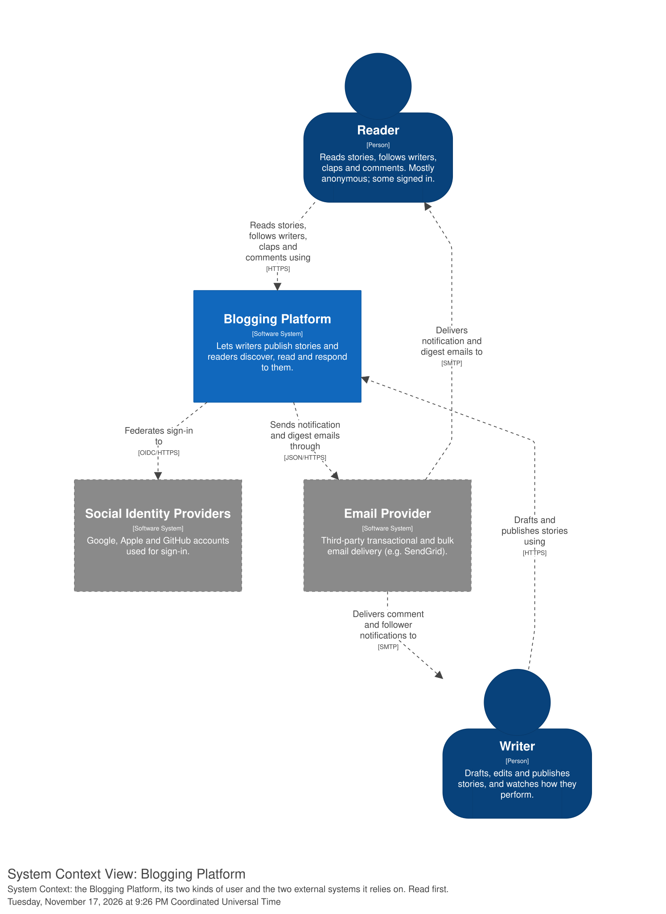
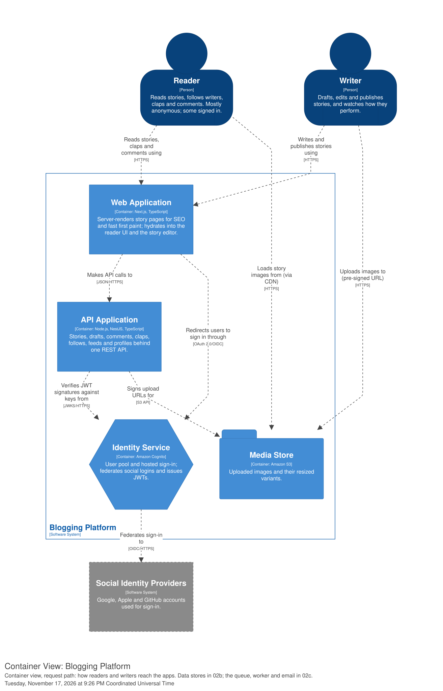
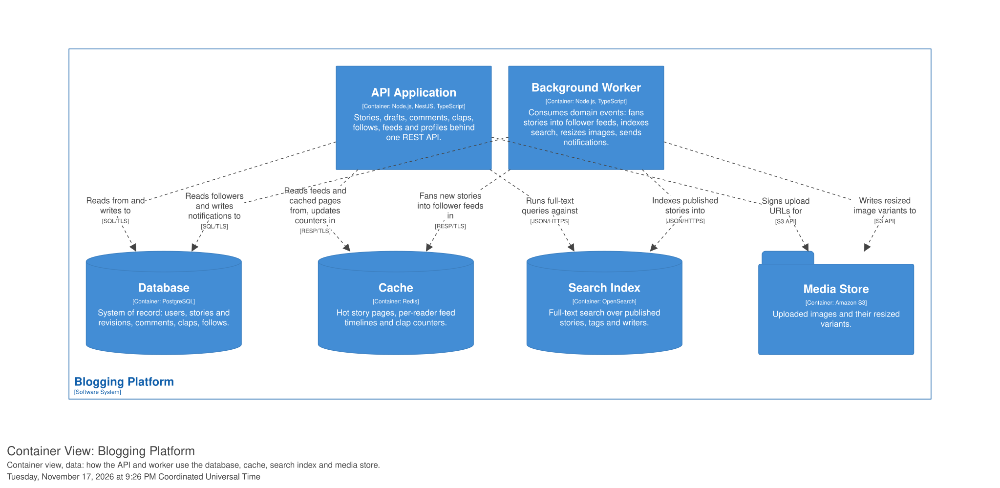
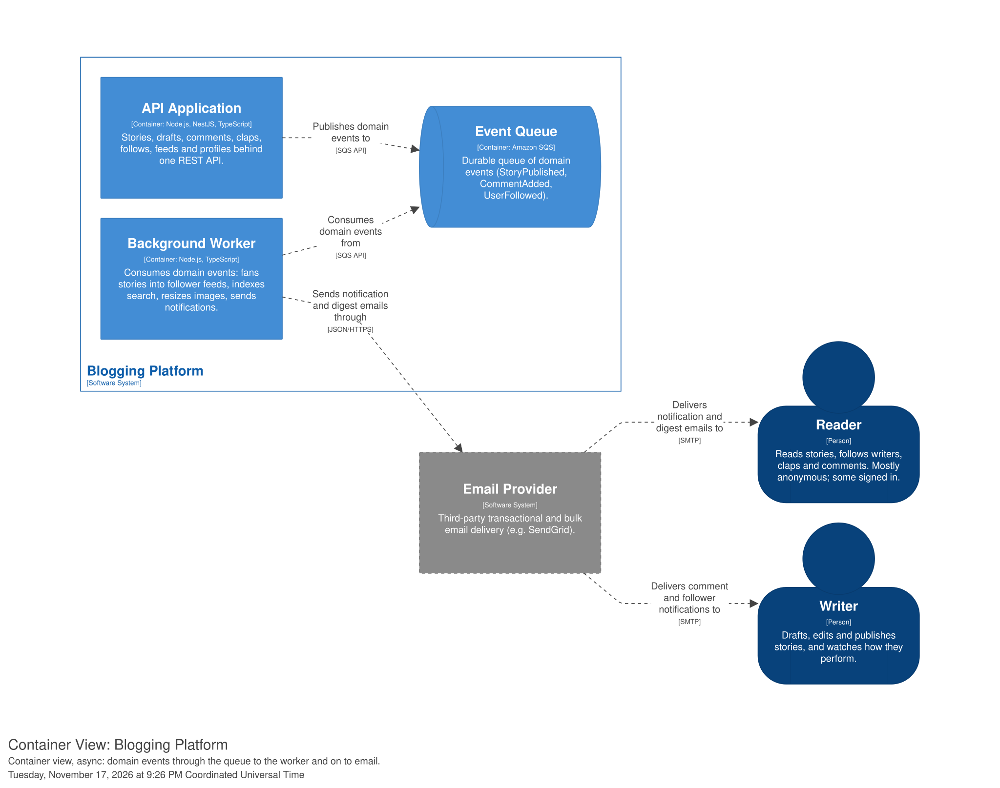
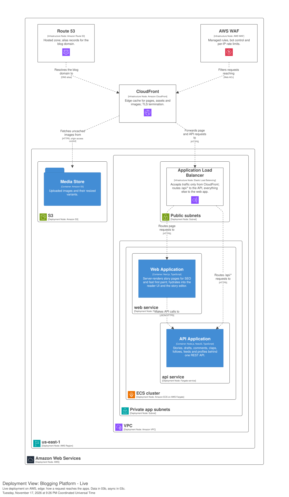
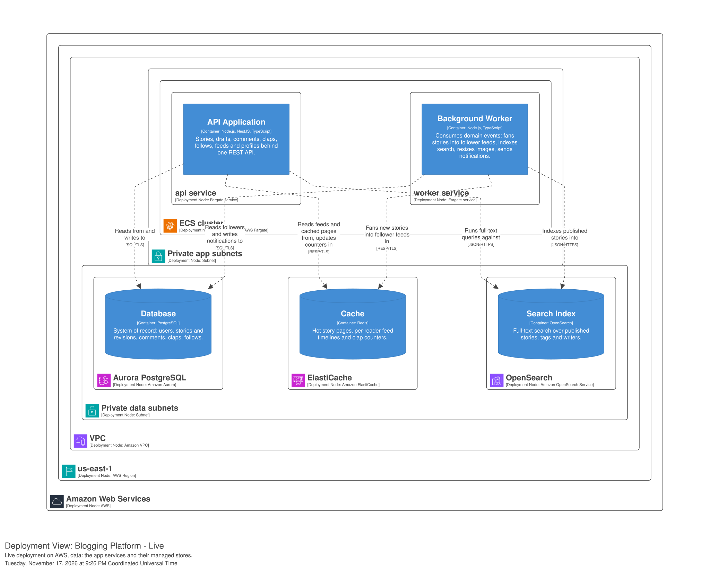
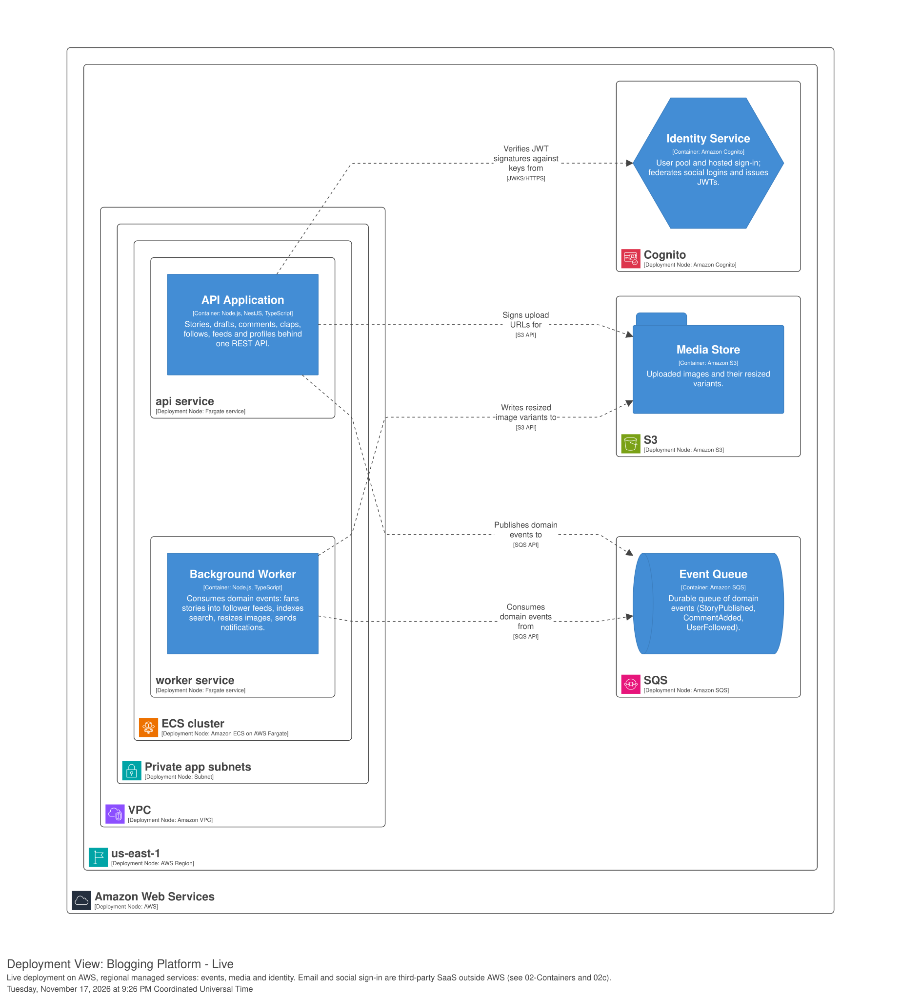

# Sample: blogging platform on AWS (scope given up front, deployment view with icons)

What the skill does when the scope is already in the prompt: no questions, straight to System Context, Container, and Live deployment views on AWS with the bundled AWS icon theme. It also wrote a system-design note and three proposed ADRs, because the prompt asked for "a system design".

Generated 2026-11-17 by running the real skill headless, unedited: `claude -p` with the `allensanborn-skills` plugin loaded from commit `78fbf50` (`--plugin-dir`), model `claude-opus-5-5`, Tier 1 (Docker, headless Structurizr `2026.10.26-playwright`, no MCP), user settings excluded (`--setting-sources project,local`) so no personal instructions leaked in. Cost: $1.61, 46 agent turns, one user turn. This is eval case 13's prompt.

This run is the second one. The first drew the whole AWS deployment as one 28-element view, 8393 px wide, which GitHub shrinks until nothing can be read. The skill now measures each image against the width it will be shown at (see *Legibility at size* in the review checklist), so this run split the deployment by concern (edge, data, async) and the container view by role.

## Output

| File | Width |
| --- | --- |
| [01-SystemContext](./01-SystemContext.svg) | 1791 px |
| [02-Containers](./02-Containers.svg) | 1920 px |
| [02b-Containers-Data](./02b-Containers-Data.svg) | 2900 px |
| [02c-Containers-Async](./02c-Containers-Async.svg) | 2480 px |
| [03-Deployment-Edge](./03-Deployment-Edge.svg) | 2292 px |
| [03b-Deployment-Data](./03b-Deployment-Data.svg) | 3022 px |
| [03c-Deployment-Async](./03c-Deployment-Async.svg) | 2690 px |

| Other file | What it is |
| --- | --- |
| [workspace.dsl](./workspace.dsl) | The one model every view comes from |
| [docs/01-system-design.md](./docs/01-system-design.md) | Requirements, sizing, flows, data model, reliability |
| [adrs/](./adrs/) | Three proposed decision records |
| [VIEWS.md](./VIEWS.md) | The view index the run wrote as `docs/architecture/README.md`; renamed so it doesn't replace this page, and its image links repointed from `exports/*.png` to the SVGs here |

## Transcript

<!-- Verbatim chat output: chat-style lists and bold leads are kept as written. -->
<!-- markdownlint-disable MD032 MD034 MD036 -->
### Turn 1

**User:**

> Design a Medium-style blogging app and a system design for running it on AWS. Show me the different levels of C4 diagrams, including a deployment diagram with AWS icons.
>
> Scope answers up front, so you don't need to ask: the audience is our engineers plus an AWS design review; the system is the blogging platform, one system in one workspace; the actors are readers and writers; the external systems are an email provider and social sign-in; draw System Context, Container, and a Live deployment view on AWS.

**Skill:**

I built the design and seven C4 diagrams: System Context, three Container views and three Live deployment views on AWS with AWS icons. The model passes Structurizr's validate and inspect checks with no issues. I looked at every image after rendering and fixed what was broken. Nothing is committed yet.

The single model file is `docs/architecture/workspace.dsl`; the images are in `docs/architecture/exports/` as PNG and SVG, with a legend image next to each. `docs/architecture/README.md` lists the views in reading order and has the command to regenerate them.

## The design

- **People and outside systems:** readers and writers; an outside email provider; and Google/Apple/GitHub sign-in, connected through Amazon Cognito so the platform never stores passwords.
- **Containers:**
  - A Next.js web app that renders story pages on the server, which helps search ranking and lets CloudFront cache whole pages.
  - A NestJS API, the only thing that writes to the database.
  - A background worker for slow work: filling followers' feeds, search indexing, image resizing and email.
  - Data: PostgreSQL as the main database, Redis for feeds, clap counts and hot pages, OpenSearch for search, SQS as the event queue, and S3 for images.
- **On AWS:** Route 53 → CloudFront with WAF → load balancer in public subnets → ECS on Fargate in private subnets → Aurora, ElastiCache and OpenSearch in separate private subnets. Everything runs across 3 Availability Zones in one region.
- **Supporting documents:** `docs/01-system-design.md` covers requirements and size estimates, the main flows (reading, publishing, home feed, claps, sign-in, image upload), the data model, disaster recovery, security, cost, and open questions for the AWS review. There are also three decision records: ECS on Fargate, Aurora PostgreSQL, and how home feeds get filled.

The context and container views fit one image each. The deployment had to be split three ways (edge, data, async) because a single image would have been too wide to read.

## What looking at the images caught

Validation passed on all of these, so I only found them by viewing the images:
1. **Main container view:** the worker was left with only stray lines once the queue was moved to another view, and the people-to-S3 lines crossed the whole image. I narrowed it to the request path; the queue, worker and email are now in their own view (02c).
2. **Edge deployment view:** the VPC box overlapped Cognito, and later S3. I moved Cognito to the async view and hid the API→S3 line in this one view.
3. **Async deployment view:** the outside email provider box was drawn on top of the AWS box. I removed the outside services from the deployment views; they still appear in the context and container views.

**Still open:** three images (02b, 03b, 03c) are 2,700–3,000 px wide. That's fine for review slides but slightly too wide to read in a README on GitHub; if they're going into a README I'll split 03b further.

## Questions for you before the AWS review

1. **Is the identity service really part of the platform?** I drew Cognito as one of your containers because you configure it and own its user pool. If the review treats managed AWS services as outside the system, it should become an external system, which changes both the context and container views.
2. **Is "Email provider" a third-party service or Amazon SES?** You named it as an outside system, so it sits outside AWS. If it's SES, it moves into the region and gets an icon on the async deployment view.
3. **What happens if the queue is down when someone publishes?** The design writes an "outbox" row alongside the story and retries from it, but the diagrams don't show that. If the review will ask about at-least-once delivery, a step-by-step flow diagram for publishing would answer it better.
4. **The planning numbers are mine:** 5M monthly readers, roughly 5,000 requests per second at peak, and about a 1-hour recovery time if the region is lost. Most of the sizing depends on them, so please confirm or replace them.
5. **Feed filling for very popular writers:** writers with more than about 50,000 followers have new stories merged into readers' feeds when the feed is read, instead of being copied into every feed at publish time. Is that cutoff a real requirement, or should v1 start simpler?
