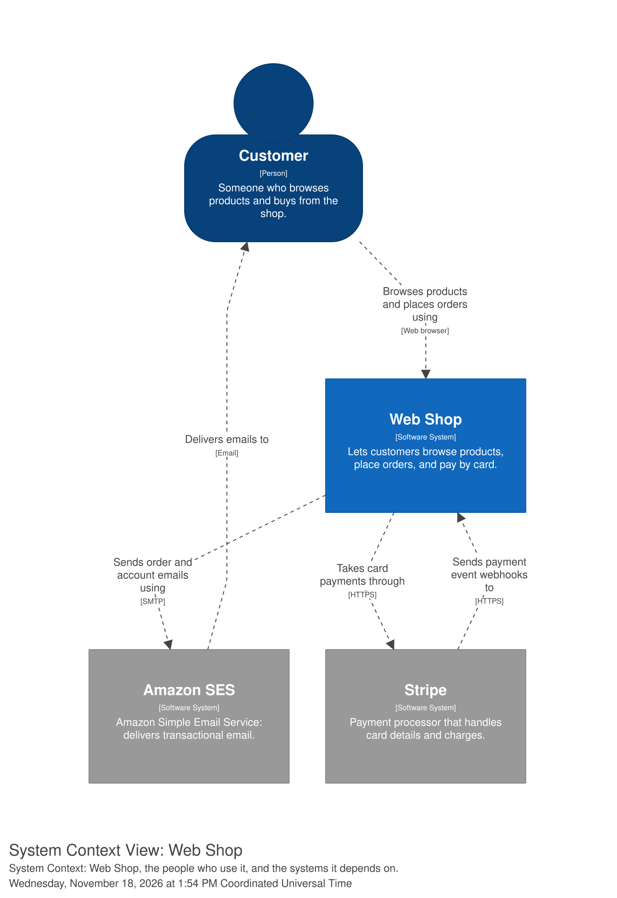
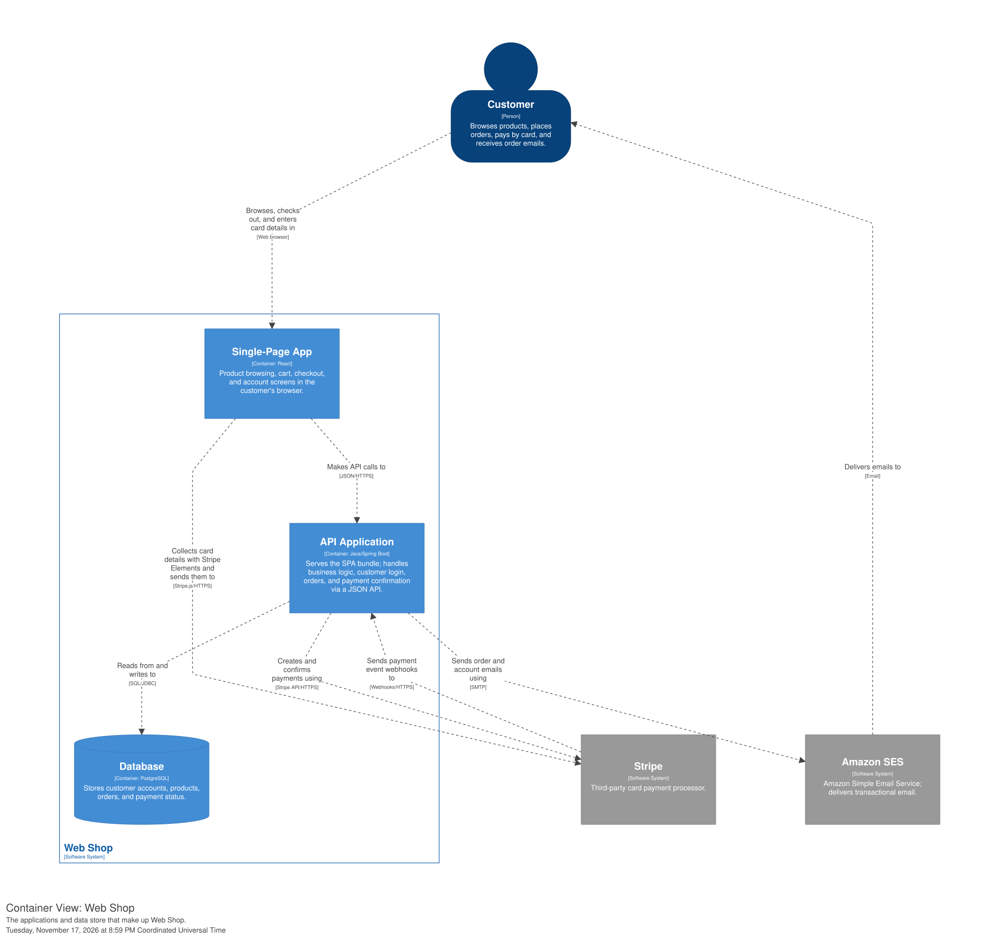

# Sample: web shop (grilled from a one-line prompt)

What a typical first run looks like: a bare request, the **scoping grill** one question at a time, then validated and rendered System Context and Container views, then the first **review grill** question changing the model.

Generated 2026-11-18 by running the real skill headless, unedited: `claude -p` with the `allensanborn-skills` plugin loaded from commit `a22137a` (`--plugin-dir`), model `claude-opus-5-5`, Tier 1 (Docker, headless Structurizr `2026.10.26-playwright`, no MCP), user settings excluded (`--setting-sources project,local`) so no personal instructions leaked in. The skill's replies below are verbatim; only the headings between turns are added. Total cost: $2.86 across 8 turns. The user answers were scripted to read like a real developer's: mostly accepting the recommendation, sometimes adding a detail (Amazon SES, Stripe) that the grill then folded in.

This is the second run. The first used default spacing and drew a 3345 px wide Container view, which shrinks until its labels are about 6 px in a README. The skill now measures each image against its display width, so this run tightened the spacing (`autolayout tb 200 50`) and checked the result.

## Output

| File | Size |
| --- | --- |
| [SystemContext.svg](./SystemContext.svg) | 1387 x 2017 px |
| [Containers.svg](./Containers.svg) | 2878 x 2883 px |
| [workspace.dsl](./workspace.dsl) | The one model both views come from |

## Transcript

<!-- Verbatim chat output: chat-style lists and bold leads are kept as written. -->
<!-- markdownlint-disable MD032 MD034 MD036 -->
### Turn 1

**User:**

> I have a web app: a React SPA, a Spring Boot API, and a Postgres database. Customers use it; it also emails them via our SMTP server. Draw the C4 diagrams.

**Skill:**

Your config is already set up: Tier 1 (Docker), diagrams go in `docs/architecture/`, and the review grill is on.

Before I write any DSL, I have six quick scoping questions: audience, the system's boundary, one system or many, people, external systems, and which C4 levels to draw. You've already answered some of them, so most will just be confirming my suggested answer.

**Question 1 of 6: Audience and purpose**

Who will read these diagrams, and what should they help with? For example: onboarding a new engineer, a design review, or explaining scope to a non-technical stakeholder.

*My suggestion:* **developers on your team, to share one picture of how the system fits together.** That means showing technology (React, Spring Boot, PostgreSQL, SMTP) on each box and arrow. If the readers are non-technical, I'd leave technology off the System Context view.

Reply "yes" to accept, or tell me who the readers are.

### Turn 2

**User:**

> Yes, developers. Mostly for onboarding new engineers.

**Skill:**

Got it: developers, for onboarding. Every box and arrow will show its technology.

**Question 2 of 6: The system's boundary**

What is the one software system these diagrams are about? Everything inside the boundary is part of it; everything else is a person or an external system.

*My suggestion:* **one system (I'll call it "Web Shop" unless you give me its real name) made up of the React SPA, the Spring Boot API, and the Postgres database.**

One thing to settle: you called it "*our* SMTP server." Does your team build and run it as part of this app? If so, it goes inside the boundary as a container. Or is it shared company infrastructure, or a provider like SES or SendGrid? Then it goes outside as an external system. I'd guess **external**: onboarding engineers don't need to know how it works inside, only that the API sends email through it.

What's the system called, and where does the SMTP server belong?

### Turn 3

**User:**

> Yes, call it Web Shop. The SMTP server is Amazon SES.

**Skill:**

So the system is Web Shop, and Amazon SES goes outside the boundary as an external system. Your team doesn't own it; the API sends email through it.

**Question 3 of 6: One system or many?**

Is Web Shop the only system in scope, or is it one of several systems owned by different teams or repos (an order service, an inventory system, and so on) that you also want on these diagrams?

*My suggestion:* **one system, one workspace.** From what you've described (SPA + API + DB, plus SES), this is a single system owned by a single team. That's Structurizr's default, and it's the simplest model for onboarding. If other internal systems call Web Shop or are called by it, tell me. They'll show up as external systems, not as part of this workspace.

### Turn 4

**User:**

> One system. We also take card payments through Stripe, if that matters.

**Skill:**

Yes, Stripe matters. External dependencies like that are the thing most often left off these diagrams. It joins SES as an external system, and I'll ask how it connects in question 5.

**Question 4 of 6: People**

Who uses Web Shop? You mentioned **Customers**. Is anyone else? For example, staff or admins who manage products, orders, or refunds, maybe through an admin area of the same SPA or a separate back-office tool. Or support agents looking up orders.

*My suggestion:* **Customer** plus a **Shop Administrator** (staff who manage the catalogue and orders), *if* such a role exists in the app. If staff only ever work in the Stripe dashboard or directly in the database, leave them out. A role that never touches Web Shop doesn't belong on its diagrams.

Is it just Customers, or are there other roles?

### Turn 5

**User:**

> Just customers for now.

**Skill:**

The only person on the diagrams will be **Customer**.

**Question 5 of 6: External systems**

So far there are two: **Amazon SES** (email) and **Stripe** (payments). Two things to pin down:

**a) How does Stripe connect?** The arrows depend on it. The usual setup:
- the **SPA** loads Stripe.js / Elements so card details go from the browser straight to Stripe and never touch your API,
- the **API** calls the Stripe API to create and confirm PaymentIntents,
- **Stripe** sends **webhooks** back to the API (payment succeeded, failed, refunded).

*My suggestion:* **all three arrows**, unless you use Stripe Checkout (a redirect to a Stripe-hosted page) or the API handles card data itself.

**b) Anything else?** For example, a login provider (Auth0, Cognito, Google sign-in) or Spring Security with users stored in Postgres, analytics, a CDN or object storage for product images, or shipping or tax APIs. My guess is **nothing else, with login handled by the API and Postgres**. But anything left out here won't appear on the diagram.

### Turn 6

**User:**

> Yes, all three Stripe arrows: the SPA uses Stripe Elements, the API confirms the payment, and Stripe sends webhooks to the API. Login is our own, in the API. Nothing else.

**Skill:**

Here's the full set of connections:
- **SPA → Stripe**: card details collected by Stripe Elements (HTTPS)
- **API → Stripe**: confirms payments (HTTPS/JSON)
- **Stripe → API**: payment-event webhooks (HTTPS)
- **API → SES**: sends emails (SMTP)
- Login is handled by the API, with users stored in Postgres, so there's no separate login system.

**Question 6 of 6: Which C4 levels to draw now**

*My suggestion:* **System Context + Container**, both built from one model:
- **System Context:** Customer, Web Shop as a single box, Stripe, and Amazon SES. This is the big picture a new hire sees on day one.
- **Container:** inside Web Shop, the React SPA, the Spring Boot API, and the Postgres database, with each Stripe and SES connection attached to the container that actually makes it.

I'd **skip the Component level** (the inside of the API) for now. At onboarding it goes stale faster than it helps, and we can add it later if the API's internals need explaining. A **Deployment** diagram (where everything is hosted) is also optional; tell me if you want one and what it runs on.

Shall I go ahead with System Context + Container?

### Turn 7

**User:**

> Yes, Context and Container.

**Skill:**

I've drawn both diagrams and checked them. Here's where they are:

- **Model (single source of truth):** `docs/architecture/workspace.dsl`
- **Images:** `docs/architecture/exports/SystemContext.png` and `Containers.png` (plus `.svg` versions and a `*-key` legend for each)

**What I checked:**
- **Validation:** the DSL parses cleanly.
- **Lint:** the model lint flags only that Web Shop has no written docs or architecture decision records (ADRs) attached. That isn't a problem with the diagrams, so I left it.
- **Contents:** System Context has 4 elements and 5 arrows. Containers has 6 elements and 8 arrows. Neither view is empty, and nothing extra got pulled in.
- **Readability:** both images are under about 3000px wide, so labels stay readable in a README column (1387px and 2878px).
- **Context diagram:** reads cleanly.
- **Container diagram:** readable, but the three Stripe arrows all come into the same side of the Stripe box, so that corner is a bit busy. It's tolerable, and fixing it would mean hand-tuning the layout in `structurizr local`.

**About the context view:** I declared one arrow, "Web Shop takes card payments through Stripe", directly at the system level. Without it, the context view would have shown whichever container-level Stripe arrow came first, such as "Sends card details to, via Stripe Elements", which is misleading at that level.

The review questions are next, one at a time.

**Review question 1: Who serves the SPA?**

The React SPA has to be downloaded by the customer's browser from somewhere, and nothing on the diagram says where. A new engineer will wonder. Common answers:
- **(a)** The Spring Boot API serves the built bundle as static resources. Then I'd add "API delivers the SPA to the browser" and no new box.
- **(b)** A CDN or static host (S3 + CloudFront, Netlify, Vercel). That's usually hosting rather than a C4 container, so it belongs on a Deployment diagram, not these two.
- **(c)** A separate web server container (nginx) that your team runs.

*My suggestion:* if it's **(a)**, add that one arrow. If it's **(b)**, leave both diagrams as they are and add a line to the SPA's description, e.g. "served as static files from CloudFront".

Which is it?

### Turn 8

**User:**

> (a), Spring Boot serves the bundle. That's enough review for now, thanks.

**Skill:**

I've added the arrow and stopped the review there. Both diagrams are finished, and I re-rendered and checked them after the change.

**What changed:**
- New arrow: **API Application → Single-Page Application**, "Delivers the SPA's static bundle to the customer's browser" `[HTTPS]`.
- The API's description now starts "Serves the SPA bundle; …".
- The context view is unchanged.

**Checks after the change:** the DSL still parses. Context has 4 elements and 5 arrows; Containers now has 6 elements and 9 arrows. The container image is 2878px wide, still within the ~3000px that stays readable in a README. The new arrow and its label don't overlap anything else. The Stripe corner is still a little busy, as before, but readable.

**Files** (in `docs/architecture/`):
- `workspace.dsl`: the model both diagrams are generated from; edit this, not the images.
- `exports/SystemContext.png` / `.svg`: the System Context diagram, to read first.
- `exports/Containers.png` / `.svg`: the Container diagram, the zoom into Web Shop.
- `exports/*-key.png` / `.svg`: legends.
- `exports/workspace.json`.

**Loose ends:**
- **Arrow labels:** the review questions I didn't get to would have gone through each arrow's wording. The labels are specific and point the right way, so this is optional.
- **Lint:** it still flags that Web Shop has no written docs or ADRs attached. Adding a short `docs/` folder and decision records later would clear it, and it would fit an onboarding set well.
- **Re-rendering:** each PNG carries a render timestamp, so every re-render changes every image even when nothing else did. Before committing, restore any image you didn't mean to change.
- **Git:** nothing is committed. You're on `master`, and the main branch is `main`.
